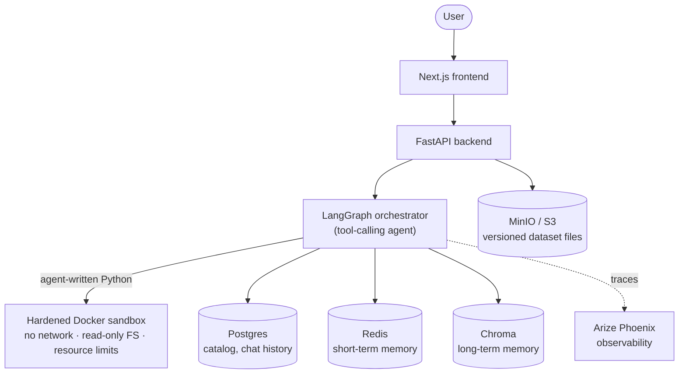

# Architecture

This document explains how AIDataAgent is put together and why it's built the way it is. For setup/usage, see [README.md](README.md).

## The core idea

Most "chat with your data" tools translate every question into SQL. That works for simple lookups and falls apart the moment someone asks for a regression, a hypothesis test, or a chart with an unusual bucketing rule.

This project takes a different approach: the agent writes and executes real Python — pandas, DuckDB, scikit-learn, Plotly, whatever the question needs — inside a sandbox built specifically to contain it. It reasons about data the way an analyst would, instead of being boxed into one query language.

## System overview



**Backend** (FastAPI): owns ingestion, the chat API, and the transform/versioning endpoints.
**Agent** (LangGraph): a tool-calling orchestrator — one LLM node bound to five tools (`query_data`, `make_chart`, `run_eda`, `propose_transform`, `propose_join`) decides what a question actually needs, rather than forcing it through a fixed classifier.
**Sandbox**: every piece of agent-generated code runs in a brand-new, ephemeral Docker container — no network access, read-only root filesystem, memory/CPU/process limits.
**Frontend** (Next.js): chat UI, a Data Explorer for schema/samples/version history, dark mode, the works.

## Design decisions worth explaining

### An agent that calls tools, not a fixed router

The first version of the Q&A engine classified every question into exactly one of a closed set of routes (SQL, pandas, chart, EDA, transform, join, or "ask for clarification"). That shape has no slot for anything that isn't a fresh data request — a follow-up asking to interpret a prior result, a plain "yes" confirming something the agent itself just offered, or ordinary conversation all got force-fit into "clarify." In practice this produced a real, reproducible bug: a conversation would get stuck re-asking a near-identical clarifying question even after the user had already answered it, because nothing in that architecture could route a plain "yes" anywhere useful.

The fix wasn't a patch — it was rethinking the decision layer. The current orchestrator is tool-calling: the model decides whether a question needs zero, one, or several tools, and answers directly (no tool call at all) for anything that doesn't need fresh computation. Every tool is a thin wrapper around the exact same deterministic execute/verify/retry pipeline the original design used, so none of the hardened logic was thrown away — only the decision-making on top of it changed.

### Version control for data, not just code

Every dataset transform or join is a *preview* first — nothing is ever applied directly. A proposed change runs against a copy, produces a diff (computed from the actual before/after schema, never the LLM's own account of what it changed), and sits as a pending row until a human explicitly confirms or rejects it. A confirmed change becomes a new, immutable version; nothing is ever patched in place. Undo and redo are both just repointing which version is "active" — since every version's data already exists immutably, there's nothing to recompute or risk losing.

### PII is enforced, not just prompted for

Raw row-level data never reaches the LLM — only schema, column statistics, and aggregated results do. Columns flagged as PII during ingestion (via Presidio, checked by both column name and NER on sample values) are redacted from every response at a single chokepoint, after code executes but before the result is returned. This is checked two independent ways: by column identity (a result keyed by a PII column name) and by the literal value (so something like `df["region"].unique().tolist()` — a bare list with no column name anywhere in the structure — still gets its PII-flagged values caught and redacted).

### Sandboxed execution is the real security boundary

Every execution is a fresh, network-isolated container with a read-only root filesystem and memory/CPU/process limits. A static AST pre-check on generated code exists too, but it's defense in depth — the real boundary verified directly is the container itself (writes outside the one writable scratch directory fail with real OS-level permission errors).

### Memory, two tiers

Short-term memory (Redis, capped to the last few turns) lets a follow-up like "what about EMEA?" resolve against the actual prior question instead of guessing from schema alone. Long-term memory (Chroma, embedded and filtered by user + dataset) stores corrections a user explicitly teaches the agent about a dataset ("region means the sales team's territory, not the customer's") and recalls them by semantic similarity — scoped so a fact taught by one user on one dataset never leaks to a different user or a different dataset.

### Full observability

Every LLM call and every sandboxed execution is traced end-to-end (inputs, outputs, cost, latency) via OpenTelemetry and Arize Phoenix — chosen over heavier alternatives (Langfuse, Comet Opik) specifically because it runs as a single, lightweight container instead of a multi-service stack.

### Swappable LLM backend

The chat model is instantiated in exactly one place in the codebase. Switching between OpenRouter, Google AI Studio, and Vertex AI — or between models within one of those — is a config change, never a code change.

## Bugs found and fixed along the way

A few of the more interesting ones, kept here because they're more useful as documented reasoning than as a changelog entry:

- **A pandas 3.x type-inference regression.** The datetime-detection heuristic gated on `pandas.api.types.is_object_dtype`, which stopped matching anything once pandas 3.x started reading CSV string columns as its newer dedicated string dtype instead of the legacy `object` dtype. The practical effect: no date column could be heuristically detected, and — less obviously — a genuinely free-text column misclassified as "categorical" as a side effect also suppressed PII name-detection for that column. Fixed by also checking the newer string dtype, and confirmed live that both the date detection and the PII detection recovered.
- **A silent schema regression on every confirmed transform.** Confirming any transform or join re-derived every column's type from scratch via the raw cardinality heuristic, and the LLM-assisted correction pass only ever patched the column *description*, never the *type*. The result: a column the LLM had correctly classified as continuous at upload time would quietly regress to an ambiguous heuristic guess the moment any transform was confirmed — even one that never touched that column. Fixed by carrying the parent version's type forward for untouched columns, and letting the LLM-assisted pass correct type (not just description) for genuinely new ones.
- **A PII blind spot in the redaction layer.** The column-name-based redaction check has a structural gap: code like `df["region"].unique().tolist()` returns a bare list of values with no column name anywhere in the result. Closed by adding a second, independent check against the actual flagged values themselves, read host-side (never inside the sandbox) directly from the dataset.
- **Large chart/report payloads silently breaking trace export.** Chart and EDA artifacts are multi-megabyte inline HTML. Early on, that content lived directly in the LangGraph state the tracing layer auto-serializes into every node's span — once a batch exceeded the trace exporter's size limit, the *entire* batch failed, dropping spans from unrelated requests caught in the same batch, not just the oversized one. Fixed by keeping only a short reference key in traced state and moving the real payload to a process-local side channel that's never part of what gets traced.

## Repo layout

```
apps/
  api/       FastAPI backend - chat, transforms, datasets, users
  web/       Next.js frontend
packages/
  core/      settings, DB/S3/Redis/Chroma clients, catalog ORM models
  agent/     LangGraph orchestrator, the LLM provider wrapper, memory (Redis + Chroma)
  sandbox/   isolated code-execution engine (hardened Docker container)
  tools/     pure, deterministic data operations - parsing, profiling, PII scan, charts, joins
scripts/     one-off scripts (smoke tests)
```
