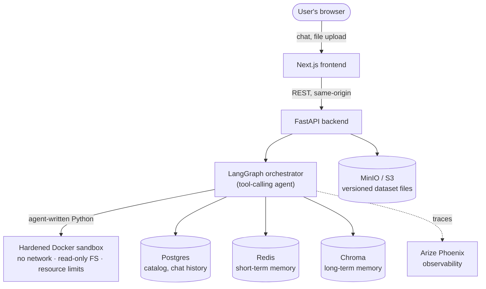

# AIDataAgent — AI Data Analysis Agent

**Upload a spreadsheet. Ask it questions in plain English. Get real answers, real charts, and real transforms — computed by agent-written Python running in a sandbox, not a brittle text-to-SQL translator.**

[](https://www.python.org/)
[](https://nextjs.org/)
[](https://fastapi.tiangolo.com/)
[](https://www.langchain.com/langgraph)
[](https://docs.astral.sh/uv/)

---

https://github.com/user-attachments/assets/c6b5867a-d2d4-407d-a72d-245e28ec1efa

## Why I built this

Most "chat with your data" tools quietly translate every question into SQL and hope the question fits that shape. The moment you ask for a regression, a hypothesis test, or a chart with a weird bucketing rule, that approach falls apart.

This project takes a different bet: let the agent **write real Python** — pandas, DuckDB, scikit-learn, Plotly, whatever the question actually needs — and run it in a sandbox built to contain it safely. The agent reasons about your data the way a human analyst would, instead of being boxed into one query language.

It started as a personal project to see how far that idea could actually be taken in production-shaped conditions: not just "can the LLM write code," but can the whole system stay safe, auditable, and trustworthy when it's handling someone's real data.

## What it can do

- **Ask anything, in your own words** — counts, aggregations, group-bys, correlations, hypothesis tests, even fitting and evaluating a model. The agent decides what tools it needs and calls them itself; it doesn't force your question into a fixed category.
- **Charts that are actually right** — common chart types (histogram, bar, pie, scatter, line, area, box, violin) are validated against your real column types before rendering, so you don't get a bar chart of a continuous column by mistake. Anything more exotic falls back to the agent writing the plotting code directly.
- **One-click EDA** — a full profiling report for any dataset: distributions, nulls, cardinality, the works.
- **Nothing changes without your say-so** — every transform or join the agent proposes (dropping a column, filling nulls, merging in another file) is a *preview*. You confirm or reject it. Every confirmed change becomes a new, immutable version — undo and redo are instant, because nothing is ever overwritten.
- **Your data stays private from the model** — raw rows never reach the LLM. Only schema, stats, and aggregated results do. Columns flagged as PII are scanned by name *and* by value and scrubbed from every prompt and every response — not just asked nicely not to appear.
- **It remembers, within reason** — short-term memory resolves follow-up questions ("what about EMEA?") against the actual conversation; long-term memory recalls corrections you've taught it about a specific dataset ("region means the sales territory, not the billing address").
- **Full observability** — every LLM call and every sandboxed execution is traced end-to-end (cost, latency, inputs/outputs) via OpenTelemetry and Arize Phoenix.
- **Bring your own model** — OpenRouter, Google AI Studio (Gemini), or Vertex AI, swappable with a single environment variable.

## How it's put together



A question never reaches the sandbox as raw user input — the agent generates the code, a static safety check reviews it, and it runs in a throwaway container with no network access and a read-only filesystem before any result comes back out. The real data only ever leaves that boundary as an aggregated answer, already redacted of anything PII-flagged.

## Tech stack

| Layer | Technology |
|---|---|
| Frontend | Next.js (App Router), TypeScript, Tailwind CSS, shadcn/ui, TanStack Query, Zustand |
| Backend API | FastAPI, SQLAlchemy |
| Agent orchestration | LangGraph, LangChain, OpenRouter / Google Gemini / Vertex AI |
| Sandboxed execution | Docker — no network, read-only root filesystem, memory/CPU/pids limits |
| Data layer | Postgres (catalog), MinIO/S3 (versioned parquet), Redis (short-term memory), Chroma (long-term memory) |
| Observability | Arize Phoenix over OpenTelemetry |
| Package management | [uv](https://docs.astral.sh/uv/) (Python workspace), npm (frontend) |

## Repo structure

```
apps/
  api/       FastAPI backend — chat, transforms, datasets, users
  web/       Next.js frontend
  worker/    async job runner
packages/
  core/      settings, DB/S3/Redis/Chroma clients, catalog ORM models
  agent/     LangGraph orchestrator, the LLM provider wrapper, memory (Redis + Chroma)
  sandbox/   isolated code-execution engine (hardened Docker container)
  tools/     pure, deterministic data operations — parsing, profiling, PII scan, charts, joins
scripts/     one-off scripts (smoke tests, user role promotion)
```

## Getting started

### Prerequisites

- [Docker](https://www.docker.com/) (for local infra + the sandbox image)
- [uv](https://docs.astral.sh/uv/) (Python package/workspace manager)
- Node.js 20+ and npm
- An API key for at least one LLM provider — [OpenRouter](https://openrouter.ai/keys) (has free models), [Google AI Studio](https://aistudio.google.com/apikey), or Vertex AI

### 1. Clone and start local infra

```bash
git clone https://github.com/mohamedsaajidn/AIDataAgent.git
cd AIDataAgent
docker-compose up -d
```

This brings up Postgres, MinIO (S3-compatible storage), Redis, Chroma, and Phoenix — all the backing services, containerized, no native installs.

### 2. Configure environment variables

```bash
cp .env.example .env
```

Open `.env` and set at minimum `LLM_PROVIDER` and the matching API key (`OPENROUTER_API_KEY` by default). Every other value already has a working local default. See `.env.example` for the full, documented list.

### 3. Build the sandbox image

```bash
docker build -t dataagent-sandbox:latest packages/sandbox
```

This is the hardened container every piece of agent-generated code actually runs inside. It's a separate build step, not part of `uv sync` — rebuild it any time `packages/sandbox` changes.

### 4. Install and run the backend

```bash
uv sync
uv run uvicorn api.main:app --reload --port 8000
```

The API comes up at `http://localhost:8000` (interactive docs at `/docs`).

### 5. Install and run the frontend

```bash
cd apps/web
npm install
cp .env.example .env.local   # set NEXT_PUBLIC_USER_ID to any stable string, e.g. your name
npm run dev
```

The app is now at `http://localhost:3000`. The frontend proxies `/api/*` straight to the backend, so there's no CORS setup to worry about.

## Taking it for a spin

1. Open the app, upload a CSV or XLSX file.
2. Ask it something straightforward: *"How many rows are there, and what columns have missing values?"*
3. Ask for a chart: *"Show me a bar chart of revenue by region."*
4. Ask for something that needs real computation: *"Fit a linear regression predicting price from the other numeric columns and tell me the R²."*
5. Ask for a change: *"Drop any rows where age is null."* — you'll get a preview with the exact before/after diff, not an instant mutation. Confirm it, then check the version history to undo it.

## Security & guardrails

This wasn't built as a toy that happens to also run code — the execution boundary was treated as the actual product requirement:

- **Sandbox isolation** — every execution is a brand-new, network-isolated, read-only-filesystem container with memory/CPU/process limits. Verified directly: writes to the filesystem outside the one writable scratch directory fail with real OS-level permission errors.
- **PII never reaches the model or the user** — detected at upload time (by column name *and* content), redacted from every prompt and every response at a single chokepoint, checked both by column identity and by raw value so it can't leak through an unnamed list of values either.
- **Two-phase changes, always** — a transform or join is proposed, never applied, until a human explicitly confirms it. Every confirmed version is immutable; undo is just repointing to an earlier version, nothing is ever deleted or recomputed.
- **Role-gated commits** — proposing a change is open to anyone; committing one requires an editor role.

## Known limitations

This is a personal project / proof of concept, not a hardened production system — worth being upfront about:

- No real authentication yet — identity is a simple, caller-supplied string, not a login system.
- Requests are synchronous (no streaming responses yet).
- Free-tier LLM models can be rate-limited or retired upstream without notice — swap the model in `.env` if that happens.
- Infra runs locally via Docker Compose by default; moving to managed cloud services is a configuration change, not a rewrite, but hasn't been done here.

## License

Not yet licensed — treat this as "all rights reserved, portfolio-viewing only" until a `LICENSE` file is added. *(Planning to add one? MIT is the common choice for a project like this.)*

## Author

Built by **Mohamed Saajid** — feel free to open an issue, or reach out if you'd like to talk through how any of this works.
